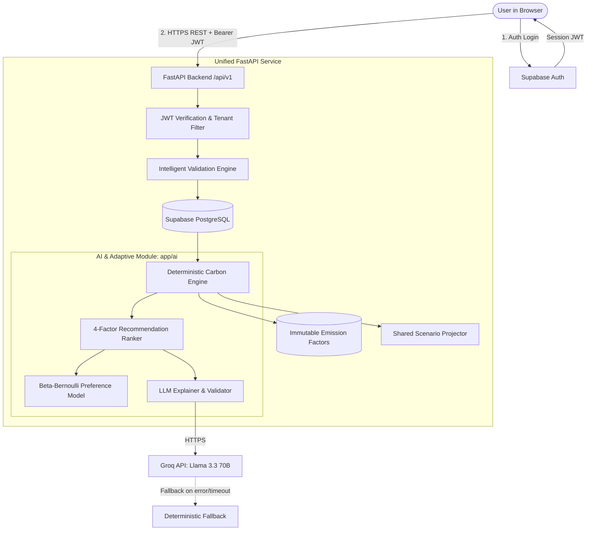

# CarbonQuest System Architecture (`docs/ARCHITECTURE.md`)

**PCCOE International Grand Challenge 2026** · *Theme: AI for Climate Change*

---

## 1. System Overview

CarbonQuest is an explainable carbon footprint auditing and adaptive sustainability intelligence platform. It establishes a closed-loop behavioral change cycle:

$$\text{Track} \longrightarrow \text{Validate} \longrightarrow \text{Calculate} \longrightarrow \text{Analyze} \longrightarrow \text{Prioritize} \longrightarrow \text{Simulate} \longrightarrow \text{Act} \longrightarrow \text{Measure} \longrightarrow \text{Learn} \longrightarrow \text{Adapt}$$

### Key Architectural Tenets (Day 0 Locks)
1. **Single Backend Service**: A unified Python FastAPI service (`backend/app`). No business logic in Next.js route handlers.
2. **Supabase for Postgres & Auth Only**: The frontend authenticates through Supabase Auth and forwards its JWT to FastAPI via `Authorization: Bearer <token>`. FastAPI verifies the JWT and extracts `sub` as `user_id`. The frontend **never queries database tables directly**.
3. **LLM Writes Words Only**: Groq Llama 3.3 70B generates natural language explanations and conversational advice. All numerical figures (kg CO₂e, percentage savings, scores, ranks, confidence) are computed deterministically by Python.
4. **Estimated vs. Measured Provenance**: Every saving carries `basis = 'estimated'` or `basis = 'measured'`. Measured savings require empirical baseline drop across at least 14 days of post-action activity.
5. **Adaptive Rule-Based Statistical Learning**: Explainable per-user preference model using conjugate Beta-Bernoulli distributions per action plus category weighting. Not ungrounded ML.

---

## 2. Runtime Architecture & Data Flow

### Request Flow
1. **User Action**: The Next.js frontend sends an action or log via REST to `/api/v1`.
2. **Validation**: The validation layer applies physical speed bounds and daily activity limits. Rejected records never reach the calculation engine.
3. **Calculation**: The deterministic engine multiplies the quantity by the versioned, sourced emission factor.
4. **Adaptive AI**: The ranking service consumes engine savings, factors in personal Beta-Bernoulli affinities, applies cooldown penalties, and requests natural language phrasing from the LLM.
5. **Response**: The frontend renders the response, differentiating Estimated from Measured metrics.

---

## 3. Technology Stack

| Layer | Technologies | Responsibilities |
|---|---|---|
| **Frontend** (T1) | Next.js 14 (App Router), TypeScript, Tailwind CSS, shadcn/ui, Recharts, Lucide Icons, TanStack Query | Responsive UI, client state, data visualizations, auth session |
| **Backend** (T2) | Python 3.11+, FastAPI, Pydantic v2, SQLAlchemy 2, Alembic, psycopg, Pandas, NumPy, PyJWT | REST API, database models, migrations, JWT auth, validation, carbon calculations, simulator, rewards |
| **AI & Adaptive** (T3) | FastAPI router (`app/ai`), Beta-Bernoulli conjugate distributions, Groq API (Llama 3.3 70B Versatile), Guardrails | Candidate ranking, adaptive Bayesian learning, explanations, grounded chatbot |
| **Persistence** | PostgreSQL (Supabase / local SQLite fallback) | Relational storage, referential integrity with cascade deletes |
| **Contracts** | Markdown, OpenAPI 3.1, committed JSON examples | Single source of truth across teammates |

---

## 4. Multi-Tenant Security & Privacy Guarantees

- **Authentication Invariant**: Every API endpoint (except `/health`) verifies the Supabase JWT and binds queries strictly to the token's `sub` claim. No endpoint accepts `user_id` as a client-provided parameter.
- **GDPR Compliance**:
  - `GET /api/v1/me/export`: Generates an archival JSON export of the user's complete carbon data.
  - `DELETE /api/v1/me`: Triggers cascade deletion of all user records, activities, preference weights, and logs.
- **Zero Secret Exposure**: `GROQ_API_KEY`, database connection passwords, and JWT secrets exist only in backend environment variables.
